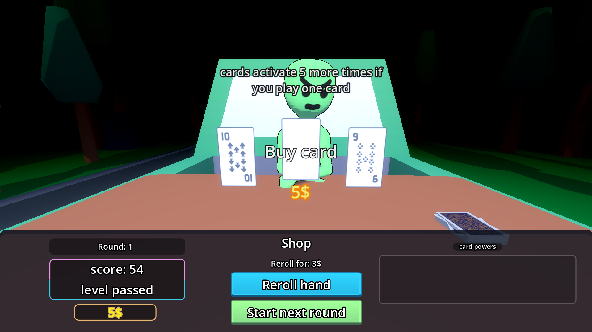

<h1 align="center">Cashless Drive</h1>

<h3 align="center">A browser roguelike incremental card game about an alien who will take you home, as long as you score enough.</h3>

<p align="center">
  
  
  
</p>

<p align="center">
  <a href="https://duc-k.itch.io/cashless-drive">
    
  </a>
</p>

https://github.com/user-attachments/assets/d64658b3-5af6-4745-b365-2ed736ea23a5

<p align="center">
  <a href="#about">About</a> |
  <a href="#play">Play</a> |
  <a href="#how-it-works">How it works</a> |
  <a href="#controls">Controls</a> |
  <a href="#features">Features</a> |
  <a href="#run-it-in-godot">Run in Godot</a> |
  <a href="#credits">Credits</a>
</p>

---

## About

You're trying to get home when you realize you don't have any cash for the bus ticket. Luckily, a stranger stops by and asks if you need a lift. You've been saved, or so you thought. To survive the trip, you have to play a game with Bob and score enough points. Who knows what happens if you lose?

Cashless Drive is inspired by Balatro. I wanted the player to start with cards that have no combos, and then let them build up every combo through upgrades. In the end, you'll have a huge number of upgrades working together.

Every run starts with no upgrades. Like other roguelikes, every run is different, and only your knowledge of the game decides how far you get.

### Game modes

- **Story mode:** the task is simple: beat 10 rounds to earn your ride home. Then run for your house before Bob decides he wants to play some more.
- **Infinite mode:** compete with others on the global leaderboard. Reach the highest round you can, submit your score, and show off your place.

The base of the game was made by two people for the GMTK Game Jam. It was then polished and improved by @Ducki after the jam for Stardance.

## Play

- **Play in your browser:** [duc-k.itch.io/cashless-drive](https://duc-k.itch.io/cashless-drive)
- **Watch a story mode playthrough:** [Playthrough on YouTube](https://youtu.be/qnOeJTpKZoo)

No download or installation is needed.

## How it works

1. Select cards from your hand and play them.
2. Your hand is scored, and your score builds toward the round's target.
3. You earn shop tokens as you go.
4. Spend the tokens on upgrades in the shop.
5. Repeat, getting more score every round.

## Controls

| Mode | Controls |
| --- | --- |
| Infinite mode | Mouse only |
| Story mode | `W` `A` `S` `D` to move around, `Shift` to sprint during story scenes |

## Features

- **A full card game:** select cards, play hands, and watch your score get calculated with a load of effects.
- **56 upgrades:** buy them in the shop to build your own combos.
- **Story mode:** beat 10 rounds to get home.
- **Infinite mode:** go for the highest score you can, then submit it.
- **Global leaderboard:** compete with others for a place on the board.



### Card values

Some upgrades use card sums. For those who don't know the value of the face cards:

Jack - 10   
Queen - 10  
King - 10   
Ace - 11

## Run it in Godot

You'll need Godot **4.6 or newer**.

1. Clone this repository:

   ```sh
   git clone https://github.com/Duckwastakon/GMTKGameJam2026.git
   ```

2. Open Godot, choose **Import**, and select the project folder (the one that contains `project.godot`).
3. Wait a moment while Godot imports the assets the first time.
4. Press `F5` to run the game.

## Project status

The game is finished for now, as it was intended.

## Credits

- **Background music:** <a href="https://pixabay.com/users/jorisvermeer-51604229/">JorisVermeer</a> on Pixabay.